# Anti Vibecoders Club

  

Uma skill de IA para **Claude** e **Codex** que transforma sites gerados rapidamente em experiências com intenção, identidade e qualidade de produção.

Ela ajuda o agente a revisar ou implementar interfaces sem cair nos sinais clássicos de “site vibecodado” (*vibecoded*): texto genérico, hierarquia fraca, componentes repetidos, efeitos gratuitos, acessibilidade ignorada e acabamento técnico incompleto.

> **English:** An AI skill for Claude and Codex/OpenAI agents that turns quickly “vibe-coded” websites into intentional, production-quality experiences—covering visual direction, real content, accessibility, technical SEO, performance and launch readiness.

## O que ela cobre

- direção visual coerente com marca, público e objetivo;
- conteúdo real, hierarquia editorial e CTAs claros;
- responsividade, estados de loading/erro/vazio e rotas úteis;
- SEO técnico e compartilhamento social;
- acessibilidade e redução de movimento;
- performance e uso criterioso de Motion, Lenis, Spline e Unicorn Studio;
- checklist de lançamento baseado em evidências.

## Instalação

### Codex

Copie este repositório para a pasta de skills do Codex ou instale-o pelo GitHub quando seu ambiente oferecer instalação por repositório.

> Use $anti-vibecoded-web para revisar este site e corrigir os sinais de implementação genérica.

### Claude

A pasta `claude/` contém uma versão consolidada em `SKILL.md`. Para instalar pela conta Claude, compacte a pasta `claude/` como ZIP preservando a pasta e o arquivo `SKILL.md`, depois envie o ZIP pela área de Skills. O conteúdo de apoio já está incorporado no documento consolidado.

> Revise este site e corrija os sinais de implementação genérica.

A skill é selecionada pela descrição quando o pedido se enquadra no seu escopo.

## Estrutura

- `SKILL.md`: fluxo principal e critérios de decisão para Codex;
- `references/quality-gates.md`: checklist de produção;
- `references/visual-direction.md`: como evitar estética genérica;
- `references/motion-and-3d.md`: uso responsável de motion, scroll e 3D;
- `references/library.md`: fontes e repositórios oficiais;
- `references/catalog.md`: seleção auditada e contexto de uso;
- `claude/SKILL.md`: versão consolidada para Claude;
- `AUDIT.md`: política de entrada, pontuação e revisão;
- `research/`: candidatos, itens em espera e rejeições justificadas.

## Curadoria

Links novos não entram diretamente na skill. Eles passam pela fila de pesquisa, recebem evidências e pontuação, e só então podem ser promovidos ao catálogo. Popularidade ou aparência não substituem licença clara, manutenção, utilidade específica e adequação ao objetivo da skill.

## Princípio

Um site não parece profissional porque tem mais efeitos. Parece profissional quando cada decisão visual, textual e técnica parece intencional — e continua funcionando para pessoas, dispositivos e condições diferentes.

## Licença

MIT. As ferramentas e sites referenciados mantêm suas próprias licenças e termos.

## Palavras-chave

claude skill · codex skill · ai agent skill · vibecoding · vibe coding · landing page · web design · acessibilidade · WCAG · SEO técnico · design system · claude code · openai codex · llm tools
